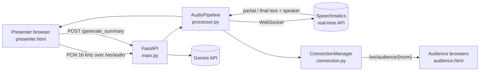

# Vani.ai

Real-time multilingual captioning for talks and meetings. A presenter speaks, the audience sees live text in their own room, and Gemini can turn the transcript into a summary with action items.

Built as a final-year capstone (team of four) and presented at ImCReTE 2026 in the paper *“Vani.ai Next Generation Multilingual Streaming Using Websockets and Edge Fallback”*. This repository is the software platform; it is under active development (see the roadmap).

## What it does today

- Streams the presenter’s microphone audio over a WebSocket to a FastAPI backend.
- Forwards the audio to the Speechmatics real-time API with speaker diarization, a custom glossary (`additional_vocab`) and partial results for fast on-screen text.
- Sends partial and final transcripts (with speaker labels) back to the presenter and broadcasts them to every audience page in the same room.
- Translation to the audience’s language happens in the browser.
- `POST /generate_summary` asks Gemini 2.5 Flash for an executive summary and action items.

## Architecture



## Quick start

```bash
git clone https://github.com/Priya-1800/Vani.ai.git
cd Vani.ai
python -m venv .venv
source .venv/bin/activate          # Windows: .venv\Scripts\activate
pip install -r requirements.txt
cp .env.example .env               # then fill in your keys
uvicorn app.main:app --reload
```

Open `http://localhost:8000/presenter.html` to present and `http://localhost:8000/audience.html` to watch.

## Configuration

| Variable | Purpose |
|---|---|
| `SPEECHMATICS_API_KEY` | Speechmatics real-time API token |
| `SPEECHMATICS_URL` | Speechmatics real-time WebSocket URL for your region |
| `GEMINI_API_KEY` | Gemini API key for summaries and Vani Bot. Without it (or if Gemini fails) both fall back to a simple answer built from the transcript |
| `GEMINI_MODEL` | Optional. Gemini model name, default `gemini-2.5-flash` |
| `REDIS_URL` | Redis connection URL. Required on Vercel so the presenter and viewers share a room across function instances. Optional locally. |
| `APP_API_KEY` | Optional. If set, `/generate_summary` requires an `X-API-Key` header |

## Saved data

Save, History, Settings (glossary, default language, auto-save) and Profile are stored in the browser's localStorage. There are no accounts, so they stay on the device where they were created.

## Deploying to Vercel

The app deploys as one Vercel Function (`app/main.py`), and the GitHub Actions workflow in `.github/workflows/deploy.yml` deploys every push to `main`.

1. Run `vercel link` once and add three repository secrets under **Settings > Secrets and variables > Actions**: `VERCEL_TOKEN` (from vercel.com/account/tokens), and `VERCEL_ORG_ID` and `VERCEL_PROJECT_ID` (from `.vercel/project.json`).
2. Add a Redis database to the Vercel project (for example Upstash Redis from the Vercel Marketplace) so that `REDIS_URL` is set.
3. Set `SPEECHMATICS_API_KEY`, `SPEECHMATICS_URL` and `GEMINI_API_KEY` under the Vercel project's **Settings > Environment Variables**.

Things to know about WebSockets on Vercel:

- Each connection is pinned to one function instance, and the presenter and viewers can land on different instances. Rooms are shared through Redis pub/sub, which is why `REDIS_URL` is required there.
- Vercel closes every connection when the function reaches `maxDuration` (300 seconds in `vercel.json`). The presenter and audience pages reconnect automatically. The presenter's reconnect starts a new Speechmatics session, so about a second of audio can be lost and speaker labels (S1, S2) may restart.

## API

| Route | Type | Description |
|---|---|---|
| `/presenter.html`, `/audience.html`, `/edge_test.html`, `/legal.html` | GET | Frontend pages |
| `/ws/audio` | WebSocket | Presenter audio. First message is JSON: `{"source": "en", "target": "hi", "glossary": [], "room": "default"}`, then binary PCM |
| `/ws/audience/{room}` | WebSocket | Audience stream for a room. Viewers may send `{"type": "reaction", "emoji": "👏"}` (❤️ 👏 🤔 🚀), which is forwarded to the host |
| `/generate_summary` | POST | Body `{"full_text": "..."}` returns `{"summary": "...", "source": "gemini" or "fallback"}` |
| `/ask` | POST | Vani Bot. Body `{"question": "...", "transcript": "..."}` returns `{"answer": "...", "source": ...}` |
| `/contact` | POST | Landing-page contact form. Body `{"name", "email", "message"}`. Stored in the Redis list `vani:contact` (latest 500); read them in the Upstash console |
| `/docs` | GET | Interactive API documentation (FastAPI) |

## Roadmap

- [x] Real-time captions with speaker labels, glossary and audience rooms
- [x] Gemini summary and action items
- [ ] Phase 0: cleanup, README, pinned dependencies, secured summary endpoint
- [ ] Phase 1: SQLite persistence for meetings, utterances and summaries
- [ ] Phase 2: multi-agent analysis with LangGraph (cleaner, summarizer, action items, JA↔EN translator, critic)
- [ ] Phase 3: question answering over past meetings (FAISS)
- [ ] Phase 4: evaluation against the single-prompt baseline
- [ ] Phase 5: Docker, docker-compose and CI
- [ ] Phase 6: cloud deployment and demo

## Author

Priya Thakur · [GitHub](https://github.com/Priya-1800) · [LinkedIn](https://www.linkedin.com/in/priya-thakur-8701a1272)

Licensed under the MIT License.
